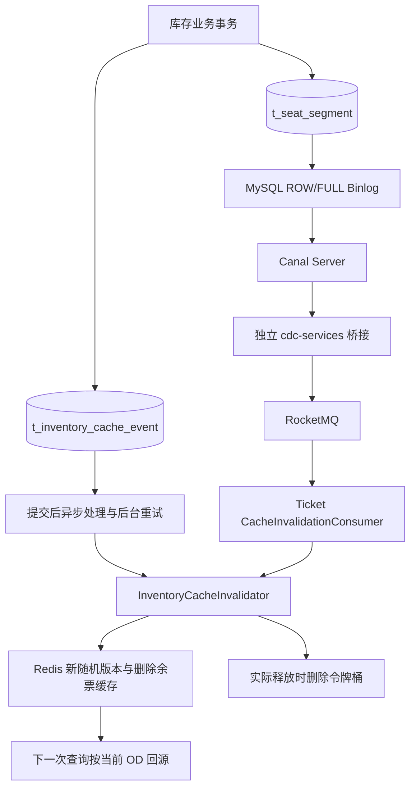
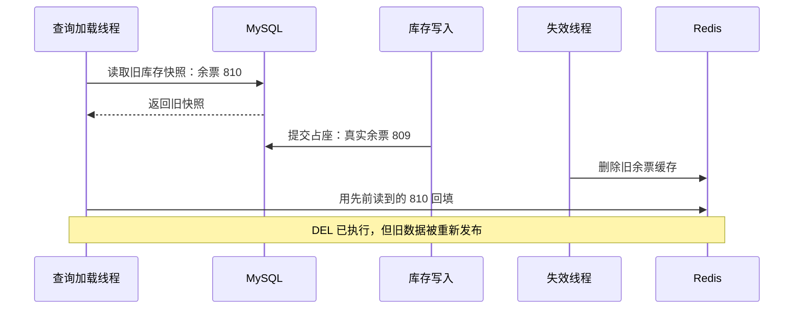

# Canal＋Binlog＋RocketMQ 缓存失效实现解读

> 本文对照当前项目代码编写，用于理解已经实现的链路。阅读顺序是业务问题、整体结构、桥接确认、消费规则、缓存版本保护、运行与验证。文中的简化代码用于解释控制流程；标为“当前代码”的片段对应实际实现。实际验证结果与尚未验证的故障场景分别说明。
>
> 文档日期：2026-10-11。库存事实源：`t_seat_segment`。接入方式：保留事务失效事件，增加 CDC 兜底通路。默认 CDC 关闭。

## 1. 本次改造解决什么问题

### 1.1 先理解数据库与缓存各自负责什么

本项目售票正确性由数据库中的区段库存和条件更新保证。余票缓存用于减少查询回源，令牌桶用于提前拒绝明显超过区段容量的请求。缓存展示“还有票”，并不意味着某个物理座位一定能覆盖完整乘车区间；最终仍要执行数据库选座和条件占座。

新增 CDC 不接管购票事务，也不决定座位归属。它负责发现已经提交的库存行变化，让相关余票缓存尽快失效。下一次查询重新计算数据库中的可售物理座位数，再写入缓存。

三项职责需要分开：

| 对象 | 负责的问题 | 能否作为最终售票依据 |
|---|---|---|
| 数据库区段库存 | 同一座位、同一基本区段的占用和归属 | 可以，由条件更新和事务保证 |
| 余票 Redis Hash | 查询展示与回源成本 | 不可以，是有 TTL 的派生数据 |
| 区段令牌桶 | 容量准入、削减无效请求 | 不可以，存在装载竞争和座位碎片化 |
| CDC 消息 | 传播库存变更，触发缓存失效 | 不可以，它传递变化，不重新裁定库存归属 |

### 1.2 当前项目已经有事务失效事件，不能忽略这一点

最初只有“数据库提交后，由应用直接删除 Redis”时，存在以下窗口：

```text
库存事务提交成功
→ 应用尚未执行 Redis DEL
→ 应用退出
→ 数据库新状态已经生效，旧缓存却还存在
```

但当前代码已增加 `t_inventory_cache_event`：在占座或释放事务内写入待处理事件，事务提交后异步处理，失败时后台扫描重试。因此，**对于正确调用了 enqueue 的业务路径，提交后应用退出并不意味着失效意图丢失**。事件记录仍然在数据库中，服务恢复后可以继续处理。

CDC 主要补充这些覆盖范围：

- 新增库存写路径忘记调用失效事件组件。
- 运维或修复脚本直接修改 `t_seat_segment`。
- 其他进程修改库存，没有执行 Ticket 的失效代码。

CDC 的变化来源是数据库 Binlog，和某个业务方法是否调用失效组件解耦。这里的“解耦”是增加数据库层观察通路；本轮并未删除业务失效事件，写事务仍然会写 outbox。

### 1.3 为什么采用双通路过渡

保留原有通路，可以继续使用已经工作的事务事件和重试；新增 CDC，则能验证覆盖遗漏写路径的效果。两条通路都调用同一个失效组件，避免分别维护两套重叠区间规则。

代价是一次正常库存变更可能被处理两次。如果第一次失效后查询刚好回填，第二次失效可能再次删除新缓存，引起额外回源。因此，双通路提供覆盖冗余，也有运行成本，不能直接表述为性能优化。

## 2. 先掌握库存模型：基本区段与 OD

假设列车经过五个站：

```text
站点索引： 0       1       2       3       4
站点名称： A ───── B ───── C ───── D ───── E
基本区段：     0       1       2       3
```

`segment_index=1` 表示 B→C。请求 A→D 转换为站点索引半开区间 `[0,3)`，覆盖基本区段 0、1、2。

当前涉及的表如下：

| 表 | 内容 | 在 CDC 中的用途 |
|---|---|---|
| `t_physical_seat` | 物理座位、车次、车厢、座号、席别 | 根据 seat_id 找到 train_id |
| `t_inventory_station` | 车次的数值站序和站名 | 根据区段生成 OD 缓存 Key |
| `t_seat_segment` | seat_id、segment_index、状态和归属 | 本轮唯一监听的库存变化表 |
| `t_inventory_cache_event` | 已提交事务待执行的失效意图 | 原有通路，继续保留 |

一条区段库存没有直接存 train_id，因此 CDC 消费者必须查询物理座位映射。该查询并非重新计算余票，只是确定变化属于哪个车次。

还要记住：直达余票统计的是“覆盖完整请求区间、全部区段均可用的同一物理座位数”。各段余票的最小值无法代替它。例如 A→B 只有 01 座可用、B→C 只有 02 座可用，两段各有一张余票，但 A→C 没有完整可用座位。这也是本轮不使用 Redis 增量加减余票的重要原因。

## 3. 整体架构：两条通路最终汇合在哪里



桥接进程和 Ticket 分开启动。桥接只负责解析和可靠转发，不依赖购票服务的运行状态。Ticket 消费者拥有库存业务规则：判断可售性、找到车次、计算受影响 OD、调用缓存组件。

这条边界使桥接更容易做确认顺序测试，也避免把站点、座位和余票算法放入基础设施转发进程。

### 3.1 主要代码入口

以下链接均指向当前工作区，可以边读本文边打开代码：

| 文件或类 | 核心作用 |
|---|---|
| [cdc-services/pom.xml](D:/Java-learning/12306Project/12306/my12306/services/cdc-services/pom.xml) | 独立模块及依赖版本 |
| [CdcApplication](D:/Java-learning/12306Project/12306/my12306/services/cdc-services/src/main/java/edu/swu/fcj/my12306/cdc/CdcApplication.java) | 连接、拉取、转发、重连与退避 |
| [EventEncoder](D:/Java-learning/12306Project/12306/my12306/services/cdc-services/src/main/java/edu/swu/fcj/my12306/cdc/EventEncoder.java) | Canal Entry 转 V1 JSON，校验、NULL 和分片 |
| [BatchForwarder](D:/Java-learning/12306Project/12306/my12306/services/cdc-services/src/main/java/edu/swu/fcj/my12306/cdc/BatchForwarder.java) | 全部发送确认后 ACK，否则 rollback |
| [InventoryCdcConfig](D:/Java-learning/12306Project/12306/my12306/services/ticket-services/src/main/java/edu/swu/fcj/my12306/biz/ticketservice/mq/InventoryCdcConfig.java) | Ticket CDC 消费者装配和参数 |
| [CacheInvalidationConsumer](D:/Java-learning/12306Project/12306/my12306/services/ticket-services/src/main/java/edu/swu/fcj/my12306/biz/ticketservice/mq/CacheInvalidationConsumer.java) | 协议校验、变更判断、车次归并与消费结果 |
| [InventoryCacheInvalidator](D:/Java-learning/12306Project/12306/my12306/services/ticket-services/src/main/java/edu/swu/fcj/my12306/biz/ticketservice/service/cache/InventoryCacheInvalidator.java) | 两条通路共用的精确失效规则 |
| [RedisCacheHelper](D:/Java-learning/12306Project/12306/my12306/services/ticket-services/src/main/java/edu/swu/fcj/my12306/biz/ticketservice/common/cache/RedisCacheHelper.java) | 版本获取、条件发布与原子失效 |
| [SeatMarginCacheLoader](D:/Java-learning/12306Project/12306/my12306/services/ticket-services/src/main/java/edu/swu/fcj/my12306/biz/ticketservice/service/cache/SeatMarginCacheLoader.java) | 缓存 miss 后按当前 OD 加载余票 |
| [InventoryCacheEvents](D:/Java-learning/12306Project/12306/my12306/services/ticket-services/src/main/java/edu/swu/fcj/my12306/biz/ticketservice/service/cache/InventoryCacheEvents.java) | 库存事务内写失效事件 |
| [InventoryCacheEventProcessor](D:/Java-learning/12306Project/12306/my12306/services/ticket-services/src/main/java/edu/swu/fcj/my12306/biz/ticketservice/service/cache/InventoryCacheEventProcessor.java) | 异步处理、保留失败事件、定期重试 |

## 4. Binlog、Canal 位点与 MQ 消费进度分别是什么

### 4.1 ROW/FULL 为何重要

ROW 模式记录行变化，使消费端可以看到哪些 seat_id、segment_index 发生变化。FULL 行镜像为 UPDATE 提供完整的前后字段，消费端才可以同时比较状态、ticket_id 和 order_sn。

如果只有部分变化字段，缺失 ticket_id 并不能解释为 SQL NULL；缺失可能只是这一列没有记录到消息中。当前编码和消费代码都检查必需字段是否存在，避免把不完整镜像误判成空闲座位。

Canal 使用复制账号读取 Binlog。示例账号拥有全局复制权限和指定目标库 SELECT 权限，库名明确配置，并把过滤范围限定到该库的 `t_seat_segment`。

### 4.2 不要混淆三个进度

| 进度 | 由谁维护 | 说明 |
|---|---|---|
| Binlog 文件与位置 | MySQL；Canal 记录读取位置 | 库存变化在源日志中的位置 |
| Canal 批次确认及 checkpoint | Canal Server，桥接调用 ACK/rollback | 哪些拉取数据已被桥接确认处理 |
| MQ 消费进度 | RocketMQ 与消费者组 | 哪些消息已被某组成功消费 |

Canal ACK 的条件是消息已经被 MQ 确认发送成功，**不是 Redis 已经删除成功**。Redis 失效失败时，RocketMQ 消费者重试；不会再回头要求 Canal 撤销先前已经成功的 ACK。

这样把恢复责任拆为两个阶段：桥接负责送到 MQ，消费者负责执行失效。两者之间没有一个覆盖 MySQL、Canal、MQ、Redis 的分布式事务。

### 4.3 文件位点持久化的边界

Canal 配置使用文件方式保存 checkpoint，路径放在独立 Docker 卷中。当前 `canal.file.flush.period=1000`，表示文件元数据按周期刷新。因此，代码中的 ACK 调用成功不能等同于“每次 ACK 都已经同步刷入磁盘”。异常退出仍可能回放已经发送过的数据，这与允许重复的设计相容。

普通停机保留数据卷；测试清理才删除本轮独立卷。恢复还依赖对应 Binlog 没有过期。如果 checkpoint 指向的日志已被 MySQL 清理，仅有位点文件不能补回历史，必须按对账和重新建立起点的流程处理。

## 5. 独立桥接进程如何工作

### 5.1 CdcApplication 的初始化

初始化主要完成四件事：

1. 校验显式源数据库名，并读取稳定的 source 标识。
2. 创建原生 RocketMQ producer，指定 NameServer，关闭 VIP 通道，发送超时设为 5 秒。
3. 创建 Canal TCP connector，指定地址、destination 和认证信息。
4. 用 EventEncoder 和同步 Sender 构造 BatchForwarder。

`source` 用于事件 ID 的生成，应该保持稳定；它不是随机的进程 ID。`destination` 是 Canal 实例标识，需要和 Server 配置一致。本轮约定一个 destination 对应一个桥接进程，不将多个进程同时接入同一个身份作为扩容方式。

### 5.2 外层连接循环与内层拉取循环

下面是控制流程的简化表示：

```java
while (进程没有被中断) {
    try {
        connector.connect();
        connector.subscribe(目标数据库 + "\\.t_seat_segment");
        connector.rollback(); // 重连后清理未确认批次，允许重新读取

        while (进程没有被中断) {
            Message batch = connector.getWithoutAck(50);
            forwarder.forward(batch);
            重置失败退避时间;
            空批次时短暂等待;
        }
    } catch (连接或转发异常) {
        等待失败退避时间;
        将退避从 1 秒逐步增加到最多 30 秒;
    } finally {
        connector.disconnect();
    }
}
```

50 是每次拉取的 Entry 批量参数，不是“恰好 50 条库存行”，也不是 MySQL 事务数。一个 Entry 可能携带多行；编码器还要把这些行拆成符合消息限制的片段。

退避避免持续故障时频繁连接和发送。成功处理后重置为 1 秒，使下一次独立故障可以较快重试。空批次短暂等待避免无数据时忙循环。

### 5.3 为什么使用 getWithoutAck

自动确认的读取方式可能在业务转发完成前推进确认进度。这里显式选择 `getWithoutAck`，把确认权交给 BatchForwarder，让“全部消息发送成功后才 ACK”成为清晰且可测试的控制流程。

## 6. BatchForwarder：整批发送确认与失败重放

当前代码的核心顺序如下：

```java
for (var entry : batch.getEntries()) {
    for (var body : encoder.encode(entry)) {
        if (sender.send(body) != SendStatus.SEND_OK) {
            throw new IllegalStateException("MQ did not confirm SEND_OK");
        }
    }
}
connector.ack(batch.getId());
```

发生异常时调用 `connector.rollback(batch.getId())`，然后将异常交给外层重连和退避。rollback 本身失败时，也不会继续 ACK，而是把 rollback 异常保留为附加异常。

### 6.1 同步发送不等于任意返回都成功

`producer.send()` 返回 SendResult，还必须检查 SendStatus。方法没有抛异常，但状态不是 `SEND_OK`，当前实现仍视为未确认成功。

Broker 示例启用 `SYNC_FLUSH`。这属于 Broker 存储配置；单 Broker 的 SEND_OK 与这一配置不能自动推导出跨机器高可用，也不能证明整个系统任何故障下都不丢消息。

### 6.2 为什么整批 ACK 会产生重复消息

假设某个 Canal 批次拆为三条 MQ 消息：

```text
M1：SEND_OK
M2：SEND_OK
M3：发送失败
```

桥接不能只确认前两条，它回滚该 Canal 批次。重新拉取后，M1、M2、M3 都可能再次发送。前两条就会重复出现。

另一种重复窗口是：全部消息发送成功，ACK 调用或响应情况不确定，桥接重连后重新读取。允许重复是为了避免把尚未确认的数据当成处理完毕。

| 情况 | Canal 行为 | 下游可能看到什么 |
|---|---|---|
| 全部发送 SEND_OK，ACK 调用成功 | 确认该批次 | 正常处理；文件刷新边界下仍允许回放 |
| 前面成功，后面发送失败 | rollback | 前面成功的消息可能重复 |
| 全部发送成功，但 ACK 结果未知 | 回滚尝试、重连 | 整批可能重复 |
| 目标 DML 解析失败 | 不 ACK、rollback | 阻塞在该批次，等待修复 |
| 单行消息超限 | 不 ACK、rollback | 不静默跳过该行 |

这是一条按至少一次思路设计、容忍重复的链路。它不是 exactly-once，也没有把一次事务涉及的所有缓存修改做成跨消息原子操作。

## 7. EventEncoder：协议、NULL 和分片

### 7.1 如何区分正常过滤与错误

事务边界 Entry、无关库、无关表返回空消息列表，可以正常过滤。对于明确属于目标表的 ROWDATA，必须解析并校验，不允许把损坏 DML 当成无关数据成功跳过。

编码器接受 INSERT、UPDATE、DELETE。INSERT 应有 after，DELETE 应有 before，UPDATE 应同时具备前后镜像。缺少必需字段、空行集合或不合法镜像都会抛异常。

目标 DDL 如果以可解析目标行变更形式到达编码器，会被拒绝。部署过滤和解析行为并不意味着 DROP、TRUNCATE、在线改表均已被支持；本轮以静态结构不在线变化为约束。

### 7.2 V1 消息字段

| 字段 | 含义 | 学习时容易混淆的地方 |
|---|---|---|
| schemaVersion | 协议版本，当前为 1 | 和数据库 schema 名称不同 |
| eventId | 源位置与分片生成的稳定标识 | 用于追踪，不用于提前跳过失效 |
| source | 稳定源标识 | 不能每次重启随机改变 |
| database、table | 变更来源 | 消费者会核对显式源库和目标表 |
| operation | INSERT、UPDATE、DELETE | 对应本条消息的行操作 |
| binlogFile、binlogOffset | 源日志位置 | 不等于 MQ 消费 offset |
| sourceTimestamp | Canal Header 中的执行时间 | 不是本轮 JDBC commit 返回时间 |
| publishedAt | 编码本次消息时的时间 | 不是 Broker 确认时刻；重发可能变化 |
| rows | before/after 行镜像列表 | SQL NULL 保留为 JSON null |

简化的占座行镜像如下。数值列在当前协议中也使用字符串，消费者显式解析坐标和状态：

```json
{
  "before": {
    "seat_id": "1001",
    "segment_index": "1",
    "seat_status": "0",
    "ticket_id": null,
    "order_sn": null
  },
  "after": {
    "seat_id": "1001",
    "segment_index": "1",
    "seat_status": "1",
    "ticket_id": "90001",
    "order_sn": "example-order"
  }
}
```

这只是 rows 中的一项，不是完整可直接发送的 V1 消息。INSERT 的 before 和 DELETE 的 after 使用 `{}`，而不是省略整个镜像字段。

### 7.3 SQL NULL 不能变成字符串 null

当前转换代码为：

```java
values.put(column.getName(),
        column.getIsNull() ? null : column.getValue());
```

需要区分三个情况：

| 表达形式 | 含义 |
|---|---|
| `"ticket_id": null` | 字段存在，数据库值为 SQL NULL |
| `"ticket_id": "null"` | 字段值是字面字符串，不是 SQL NULL |
| 完全没有 ticket_id 字段 | 镜像不完整，必须拒绝 |

消费者先检查 `containsKey`，再判断字段值是否为 null，正是为了避免把第三种情况当成第一种。

### 7.4 分片与事件 ID

每条消息最多 100 行，编码后的 JSON body 最多 256 KiB。编码器先取最多 100 行，序列化检查字节数；超限时缩小本片行数并重新编码，直至满足限制。单行仍超限则抛异常。

producer 的 maxMessageSize 为 body 限制加上额外空间；Broker 配置也保留消息头余量。判断大小的是 UTF-8 JSON 字节数组长度，而不是 Java 字符串字符数。

事件 ID 输入为：

```text
source | database | binlogFile | binlogOffset | shardIndex
```

对该字符串取 SHA-256。相同位置和分片序号重发时 ID 不变；同一 Entry 的不同分片 ID 不同。publishedAt 不参与 ID，因此重发时消息内容的发布时间可以改变，身份仍保持稳定。稳定 ID 也不表示消息已被 Redis 执行，更不提供全局消费顺序。

## 8. Ticket 消费者的加载和确认规则

### 8.1 为什么单独设置开关

InventoryCdcConfig 和 CacheInvalidationConsumer 都受 `my12306.cdc.enabled=true` 控制。它们不依赖支付通知的 `notify-mode`，因此支付使用 Feign 时仍可消费 CDC。

默认关闭可以让现有部署继续按原有事务事件工作。启用时必须明确源数据库，避免消费者不加区分地处理其他环境的库存消息。

当前消费配置为：

| 参数 | 值 | 含义 |
|---|---|---|
| Topic | my12306-inventory-cache-cdc | 独立库存缓存消息主题 |
| 消费者组 | my12306-inventory-cache-cdc-cg | 与支付组分开保存进度 |
| 订阅 Tag | `*` | 消息体仍严格按 V1 校验 |
| 批量 | 1 | 一次回调处理一条 MQ 消息 |
| 消费线程 | 4 | 消息可以并发处理，不能依赖全局顺序 |
| 最大重试 | 16 | 最终失败进入该组 DLQ |
| 起始策略 | CONSUME_FROM_FIRST_OFFSET | 无既有进度时采用的策略；不是每次重启都主动从头消费 |

### 8.2 返回消费成功前要完成哪些工作

流程是：

```text
检查 body 大小
→ JSON 解析与协议校验
→ 校验行镜像、状态和坐标
→ 判断真正需要失效的坐标
→ 批量查物理座位所属车次
→ 按车次归并区段和释放标记
→ 执行各车次公共失效逻辑
→ 全部成功后返回 CONSUME_SUCCESS
```

任何一步抛异常，consumeMessage 返回 `RECONSUME_LATER`。如果某条消息涉及多个车次，前面车次已失效、后面车次失败，重试时可以再次处理前面车次。代码没有先写“这个 eventId 已完成”，所以不会因部分成功而阻止重试。

“消息处理成功”表示失效操作完成，不表示每个余票 Key 已经重新装载。缓存删除后可能一直没有查询；这时空缓存就是正常状态。

## 9. 为什么比较可售性，而不是只比较 seat_status

### 9.1 当前可售条件

数据库查询的条件是：

```sql
seat_status = 0
AND ticket_id IS NULL
AND order_sn IS NULL
```

消费者对应实现为：

```java
return "0".equals(values.get("seat_status"))
        && values.get("ticket_id") == null
        && values.get("order_sn") == null;
```

AVAILABLE 状态但仍有归属，不应算成可售。这个判断和数据库一致，避免事件层与查询层各自定义空闲标准。

### 9.2 常见转换如何处理

| 变化 | 坐标是否改变 | 可售性变化 | 当前行为 |
|---|---|---|---|
| AVAILABLE→LOCKED | 否 | true→false | 删除重叠 OD；不再次扣令牌 |
| LOCKED→AVAILABLE | 否 | false→true | 删除重叠 OD；删除令牌桶 |
| LOCKED→SOLD | 否 | false→false | 跳过失效，支付没有改变可售数 |
| LOCKED 状态归属变更 | 否 | false→false | 跳过余票失效 |
| 状态 0，归属由非空变为空 | 否 | false→true | 失效并标记释放 |
| 可售性相同但 seat_id/segment_index 改变 | 是 | 不一定变化 | 同时处理旧、新坐标 |
| INSERT 或 DELETE | 不适用 | 根据镜像判断 | 当前保守地处理存在的坐标 |

INSERT、DELETE 不使用 UPDATE 的跳过条件。因此插入或删除一个不可售区段，也可能触发额外失效。这是当前实现的保守行为，不能宣称所有无余票影响的 DML 都被过滤了。

### 9.3 affected 中的 Boolean 是什么

消费者内部使用 `Map<Coordinate, Boolean>`。Key 是 `(seatId, segment)`，Boolean 表示该坐标是否出现新的可售容量，用来决定车次令牌桶是否需要删除；它不是库存计数，也不是区段状态。

旧坐标先标记为 false。新坐标在以下条件下标记为 true：

```text
新镜像可售，并且
    旧镜像不可售，或者旧、新坐标不同
```

合并同一坐标时使用逻辑 OR：只要本条消息中有一项变化需要释放处理，就保留释放意图。当前代码不通过这个 Boolean 向 Redis 增减数值。

## 10. 区段如何映射为受影响 OD

### 10.1 从半开区间推导公式

OD 的站点索引为 `[i,j)`，覆盖区段 i 到 j−1。基本区段 s 属于该请求范围，当且仅当：

```text
i ≤ s < j
```

这就是公共组件 affectedPairs 的判断依据。它先检查区段索引合法性，再枚举所有合法站点对，并判断是否包含至少一个受影响区段。

### 10.2 五站示例：修改 B→C

取 `s=1`。受影响 OD 为：

| 起点 | 可以受影响的终点 |
|---|---|
| A，i=0 | C、D、E |
| B，i=1 | C、D、E |

一共六个：A→C、A→D、A→E、B→C、B→D、B→E。

保留四个：A→B、C→D、C→E、D→E。A→B 在区段 1 之前结束；从 C 出发的区间在区段 1 之后开始。

对 n 个站，单个区段 s 影响的 OD 数量为：

```text
(s + 1) × (n - s - 1)
```

因为起点有 s+1 种选择，终点有 n−s−1 种选择。

### 10.3 为什么不能把不连续区段合成最大范围

如果本条消息影响区段 `{0,3}`，A→B 与 D→E 发生变化，但 B→D 只覆盖区段 `{1,2}`，应当保留。

若把变化粗略扩大为 `[0,4)`，B→D 就被误删。当前实现对每个 OD 检查“是否包含集合中的任意一个区段”，保留空隙。对多个区段，受影响集合是精确并集，不能简单把单段影响数量相加，因为长 OD 可能同时覆盖多个变化区段。

### 10.4 从座位坐标到缓存 Key

实现依次执行：

1. 收集所有旧、新 seat_id 并去重。
2. SeatMapper 用一个 IN 查询取得物理座位与 train_id 映射，排除逻辑删除座位。
3. 按 train_id 收集 segment_index 集合，并合并释放标记。
4. InventoryRouteService 获取有序、连续的站点目录。
5. 按 affectedPairs 生成 `TRAIN_STATION_REMAINING_TICKET + CacheUtil.buildKey(...)`。

一个 OD Hash 包含该 OD 的多个席别字段。当前失效删除整个 Hash，因此一张某席别车票的库存变化也可能让其他席别重新加载。这换取了较简单的原子发布和版本保护，属于可以说明的成本。

物理座位或站序找不到时，不能推测一个可能的 Key 然后返回成功，当前实现会重试并报错。该方案依赖物理座位和站序在在线阶段保持稳定。

## 11. 仅 DEL 不够：旧快照回填竞争

### 11.1 竞争发生在什么顺序

即使失效消息没有丢失，也可能发生以下事情：



加载锁只合并加载者，并不能阻止数据库写入或 CDC 失效。CDC 确保“变化会触发失效”，也不能单独消除“失效后旧读取写回”的竞争。

### 11.2 Redis 版本令牌如何阻止回填

每个 OD 还有一个版本 Key，值是随机 UUID，默认 TTL 为 120 秒。它是缓存发布许可，不是 MySQL 递增版本，也不能比较大小来判断哪个订单更新。

加载流程为：

```text
取得当前令牌 V0
→ 读取数据库
→ 发布 Lua 检查当前令牌仍是 V0
→ 相同才写入整个余票 Hash 与 TTL
```

失效流程为：

```text
生成新令牌 V1
→ 一个 Lua 内更新版本 Key 并删除余票 Key
```

查询持有 V0 时，如果失效把版本更新成 V1，查询无法再用 V0 发布旧快照。即使版本 Key 已过期，GET 返回空也不等于 V0，同样拒绝发布。

### 11.3 两段 Lua 的逻辑边界

下列是等价的简化逻辑，不是完整参数下标实现：

```lua
-- 失效：新的随机令牌和删除在同一次 Redis 脚本中执行。
SET version_key fresh_uuid EX version_ttl
DEL remaining_key
```

```lua
-- 发布：校验版本、发布 Hash、设置 TTL 在同一个脚本内。
if GET(version_key) ~= expected_uuid then
    return 0
end
DEL remaining_key
HSET remaining_key all_seat_type_counts
EXPIRE remaining_key remaining_ttl
return 1
```

原子性覆盖 Redis 脚本内的校验和发布，不覆盖外面的 MySQL 查询，也不覆盖整条 MySQL→MQ→Redis 链路。当前部署是单 Redis 场景，多 Key Lua 在 Redis Cluster 下还需要考虑 hash slot，本轮没有完成 Cluster 适配验证。

### 11.4 为什么每次重试都要生成新版本

重复事件或迟到事件若复用旧 eventId 作为版本，可能将版本重新设置成曾经出现过的值，使仍持有该值的旧加载者再次获得发布许可。

当前每次处理都生成新 UUID，不使用消息身份作为版本。即使同一事件被两条通路或 MQ 重试处理，版本也会改变，旧发布许可不会被主动恢复。

这里的幂等性需要准确理解：重复 DEL 保持安全；UUID 每次不同，所以 Redis 状态并非逐字节不变，但重复操作不会恢复错误余票，不会重复增加库存。

### 11.5 版本拒绝后查询怎么办

SeatMarginCacheLoader 在加载锁内最多读取数据库两次，即首次读取和最多一次重新读取。持续竞争时，本次读取结果仍可以返回给调用者，但不写缓存，并记录放弃回填。

因此，版本校验主要保证旧快照不会在已发生版本变化后发布到 Redis，**不承诺每个请求的返回值都与返回瞬间的数据库完全一致**。写入可能发生在最后一次读取之后，这仍是最终一致的余票查询。

热点命中不额外读取版本 Key；版本操作发生在 miss 或失效路径。余票 TTL 默认 27～30 秒，是链路未及时工作时的重要自愈条件，但持续并发和加载失败情况下不能机械地把 TTL 当成严格收敛 SLA。

## 12. 为什么释放时删除令牌桶

基本区段令牌桶描述区段容量，不描述完整可用座位集合。释放一笔订单后，不能无条件将某个 OD 令牌 `+1`，否则重复取消、重复 CDC 或旧桶已重建后重放，都可能重复归还容量。

当前方案删除整个车次的区段桶，下一次请求通过装载锁从数据库聚合重新构建。删除可以重复执行，不会产生多加令牌的问题。

还有两个边界：

- 占座消息不会通过 CDC 再次扣令牌；正常准入已经扣减，CDC 的职责是缓存失效。
- Redis 装载与数据库变化仍可并发，桶不是精确库存，数据库继续承担最终防超卖。

InventoryCacheInvalidator 先失效余票，再删除令牌桶。它们不是一个跨操作事务。如果余票失效成功、令牌删除失败，消费者返回重试，下一次两项重新执行。安全重复让这种部分成功可以恢复。

## 13. 原有事务事件通路如何继续工作

### 13.1 enqueue 必须在库存事务中执行

InventoryCacheEvents.enqueue 检查本地事务已经开启，把 train_id、区段范围和是否删除桶写入 `t_inventory_cache_event`，并注册 afterCommit 回调。

这样库存和失效意图一起提交或一起回滚。afterCommit 只负责尝试唤醒处理器，持久化事件才是恢复依据。

### 13.2 afterCommit 没有直接完成所有 Redis 工作

处理器将工作交给有界 executor，减少提交线程或车厢临界区被 Redis 延迟占用的时间。线程池拒绝任务时事件仍然在表中；后台默认每 5 秒扫描待处理事件。

这个设计依赖“事件先持久化、提交后再唤醒”。如果只有一个内存队列，没有事件表，应用退出后内存任务就无法恢复。

### 13.3 公共失效成功后才删除事件

原事件记录的是连续 `[start,end)`，处理器把它转换为区段集合，再调用与 CDC 相同的 InventoryCacheInvalidator。

公共失效完成后，通过 `REQUIRES_NEW` 事务删除事件。代码使用独立事务，避免 afterCommit 周围仍绑定原连接等资源时，事件删除没有按预期独立提交。发生异常时保留记录，不把“处理尝试过”当成“完成”。

Redis 已失效而事件删除失败，也会导致重复失效。该重复窗口与 MQ 部分成功重试一样，通过安全的重复操作处理。

## 14. 重试、死信与乱序应该怎样理解

### 14.1 上游和下游的恢复责任不同

| 故障位置 | 当前恢复方式 | 需要保留什么 |
|---|---|---|
| Canal 连接或读取失败 | 桥接重连和退避 | Canal checkpoint 与对应 Binlog |
| 解析失败、同步发送未确认 | 不 ACK，rollback 后重试 | 当前未完成批次 |
| Redis 操作或静态坐标解析失败 | MQ 返回 RECONSUME_LATER | MQ 消息与消费者组进度 |
| 重试耗尽 | 进入该组 DLQ，人工检查重放 | DLQ 原消息与错误记录 |
| 原事务事件处理失败 | 保留 DB 事件，后台重试 | t_inventory_cache_event 记录 |

单行超限或协议损坏可能持续阻塞桥接批次；这比静默跳过更容易保住变化，但也需要监控和人工修复。默认消费者线程为 4，不提供全局顺序保证；本轮操作以失效为主，不依赖消息顺序更新数字。

### 14.2 为什么不按 eventId 先去重

假设先写去重记录，再删除 Redis；删除失败后，重试看见去重记录就跳过，会丢失失效动作。若改成完成后去重，还要处理跨车次部分成功等情况。

当前采取更简单的方式：重复消息仍执行失效。对于派生缓存，重复删除通常比错误跳过更容易恢复，代价是额外回源。这并不意味着所有 MQ 业务都可以不去重；支付扣款、积分累加等副作用必须另行设计。

### 14.3 为什么迟到失效可以安全执行

旧事件不会把 Redis 余票覆盖成旧数值，它只换版本并删除缓存。下一次加载计算当前数据库快照。迟到事件可能删除已经正确的新缓存，却不会直接重建错误的历史状态。

因此安全性与性能需要分开评价：迟到 DEL 有可能增加重建，但它不像迟到 `HINCRBY` 那样直接改变库存数字。

### 14.4 DLQ 重放工具的作用和局限

[CdcReplayMain](D:/Java-learning/12306Project/12306/my12306/services/cdc-services/src/main/java/edu/swu/fcj/my12306/cdc/CdcReplayMain.java) 接收人工审查过的 V1 body JSON 文件，要求明确配置库名、Topic 和 NameServer，做大小及基本协议检查后同步发送。只有 SEND_OK 才打印成功。

它不会自动修复消息，不会删除原 DLQ 记录，也不替代消费者的完整校验。先修复导致失败的 Redis、静态数据或协议问题，再重放；否则消息会再次重试或进入 DLQ。保留 eventId 和原始镜像，便于追踪。

## 15. 部署配置为何这样安排

### 15.1 Docker 与宿主机地址必须分清

当前示例中 Canal、NameServer、Broker 在 Docker；桥接和 Ticket 在 Windows 宿主机。

| 连接 | 地址示例 | 原因 |
|---|---|---|
| 宿主机桥接→Canal | 127.0.0.1:11113 | 映射至容器内 11111 |
| 宿主机客户端→NameServer | 127.0.0.1:19876 | 映射至容器内 9876 |
| 宿主机客户端→Broker | 127.0.0.1:10991 | Broker 广播与映射端口一致 |
| Broker→NameServer | namesrv:9876 | Docker 网络内服务名和内部端口 |
| Canal→宿主机 MySQL | host.docker.internal:3306 | 不能把 Canal 容器的 localhost 当成宿主机 |

客户端通过 NameServer 得到 Broker 广播地址，后续会直接连接 Broker。因此，NameServer 能连接不代表 Broker 广播地址一定能连接。示例的端口映射只绑定宿主机 localhost；跨机器部署需要重新设置地址及暴露方式。

### 15.2 默认参数与 Docker 示例不是同一端口

桥接默认 Canal 端口是 11111，默认 NameServer 为 9876；Docker 示例为了隔离使用 11113 和 19876。运行示例必须显式覆盖：

```text
CDC_DATABASE=<目标库>
CDC_CANAL_PORT=11113
CDC_NAMESRV=127.0.0.1:19876

MY12306_CDC_ENABLED=true
MY12306_CDC_DATABASE=<同一个目标库>
MY12306_CDC_NAMESRV=127.0.0.1:19876
```

桥接的 CDC_TOPIC 与 Ticket 的 MY12306_CDC_TOPIC 必须一致。Topic 负责消息路由，consumer-group 保存消费进度；它们不是 Canal destination。

### 15.3 数据卷初始化与位点目录

Broker 镜像使用 uid 3000 运行，新建卷可能属于 root。Compose 中一次性初始化容器给该卷设置写权限，Broker 继续以镜像用户运行。

Canal instance.properties 挂载到配置目录；`canal.file.data.dir` 指向独立持久化卷，实际位点位于 destination 的 meta.dat。重新部署镜像应保留这些卷，不能把普通恢复操作和测试清理的 `down -v` 混用。

### 15.4 Topic 创建成功不等于立即可消费

Broker 创建 Topic 与 NameServer 得到新路由之间可能有注册等待。消费者还需要拿到队列分配。

验证工具依次确认 Topic 创建、NameServer 路由、消费者队列就绪，之后才预热缓存并提交 SQL。这些是启动阶段，不计入库存提交后的 10 秒失效观察窗口。该检查避免把初始化问题误认为 CDC 算法失效。

### 15.5 本轮发现的依赖兼容问题

Canal 引入的 Fastjson2 2.0.31 缺少 RocketMQ 5.5.0 编码所需方法，真实发送前出现 NoSuchMethodError。桥接显式使用与 Ticket 相同的 2.0.65，并加入 RemotingCommand 头编码测试。

这个问题说明：Maven 能编译，不能证明网络客户端的运行时依赖兼容。某些方法仅在首次消息编码时调用，真实链路测试才能暴露；加入一个有针对性的编码回归测试，可以避免每次依赖变化都要靠完整业务流程才发现。

另一个问题是 Canal 过滤器使用 Apache ORO，不能直接使用 Java Pattern.quote 的 `\Q…\E`。当前先限制库名字符，再采用兼容的目标表表达式。不能因为两个组件都写“正则”就认为支持完全相同的语法。

## 16. 性能变化应怎样分析

本轮没有做性能 A/B，因此下面描述的是代码中的成本机制。

### 16.1 热查询与写事务

余票命中仍读取原 Hash，不为了 CDC 每次读取版本，也没有新增动态本地缓存。库存主事务仍执行原有区段更新和事件写入；CDC 的拉取、转发、物理座位映射和 Redis 失效在独立或异步路径完成。

这不表示 CDC 完全没有影响：MySQL 复制读取、MQ、后台线程、Redis Lua 和额外回源都消耗资源，可能通过资源竞争间接影响查询和事务。

### 16.2 一条消息的主要成本

设消息涉及 r 行、车次有 n 个站、该车次合并后有 k 个变化区段，最终影响 M 个 OD。

| 步骤 | 当前实现的成本 |
|---|---|
| JSON 解析与变更判断 | 随消息 body 和行数增长 |
| 物理座位映射 | 去重后一个 IN SQL 查询，不是每行单独查 |
| 站点目录 | 进程内短期目录缓存命中时不回源；冷目录需要查询和校验 |
| affectedPairs | 枚举约 n² 个 OD，每个对区段集合做 anyMatch，最坏约 O(n²k) |
| 生成版本和 Redis Lua | 约 O(M)，每个 OD 更新版本并 DEL |
| 实际释放 | 额外删除该车次令牌桶，后续聚合重建 |
| 后续查询 | 缓存 miss 时按当前 OD 聚合，版本校验后发布 |

消息内按车次合并可以减少重复，但没有把所有 MQ 消息或两条通路合并为一个全局批次。不同消息覆盖同一 OD 时仍会多次失效。

### 16.3 需要区分请求失效数量和实际删除数量

某次计算出六个受影响 Key，不代表 Redis 当时存在六个 Key。没有缓存的 Key 仍会得到新版本，但 DEL 返回 0。

这会形成三种观测：失效调用次数、请求涉及 Key 数、实际删除 Key 数。后两者不同是正常情况，尤其是在双通路重复处理时。

### 16.4 为什么不能把 CDC 描述为提升缓存命中率

CDC 的作用是提高变更覆盖和缩短陈旧数据窗口。删除更及时甚至可能降低命中率、增加重建次数。它的价值需要通过正确性、遗漏写路径覆盖和传播延迟评价，性能则另行测量。

后续真正需要评估的是：重复失效次数、回源 SQL 增量、MQ 积压、消费者重试、令牌桶重建和业务尾延迟。本轮两个链路样本无法给出这些负载结论。

## 17. 指标如何读，哪些指标容易误解

| 指标 | 当前含义 | 边界 |
|---|---|---|
| cdc.bridge.send.success | 返回 SEND_OK 的消息数 | 不等于消费者完成数 |
| cdc.bridge.send.failure | forward 捕获异常次数 | 当前包含解析、发送和 ACK 等失败，名称比实际范围窄 |
| cdc.bridge.ack | ACK 调用成功次数 | 不是 Redis 成功次数，也不是文件同步刷盘次数 |
| cdc.bridge.rollback | rollback 调用成功次数 | rollback 自身失败不增加该成功计数 |
| cdc.consumer.received | 回调收到的消息数 | 重试也会增加 |
| cdc.consumer.success | 整条消息处理成功数 | 全部 UPDATE 行被跳过也可成功 |
| cdc.consumer.retry | 返回重试的回调次数 | 本轮未验证长期重试耗尽过程 |
| cdc.consumer.skipped | 无余票影响的 UPDATE 行数 | 单位是行，不是消息 |
| cdc.consumer.affected.keys | 成功处理消息涉及的 OD 数 | 不等于实际 DEL 返回值 |
| inventory.invalidation.duration | 公共失效耗时 | finally 记录，包含失败尝试 |
| cdc.consumer.source.age | 消费处理时距源事件时间的年龄 | 不是精确 DB commit→DEL 延迟 |
| cdc.consumer.message.age | 消费处理时距编码发布时间的年龄 | 重发会更新 publishedAt |

实际指标都带 `my12306.` 前缀。消费者的两种年龄在需要失效并处理成功的路径记录；全部被跳过的消息会提前返回，不采集这两个年龄样本。

Ticket 可以通过现有 Actuator metrics 查看。桥接是无 Web 进程，MeterRegistry 中有计数，但没有默认可访问的 HTTP 管理端点；生产监控需要另接导出器或管理端点。不能把“创建了计数器”描述为“已部署完整监控平台”。

## 18. 已完成的验证到底证明了什么

### 18.1 12 项逻辑测试

桥接七项测试覆盖：头编码兼容、全发送成功后 ACK、部分失败 rollback、发送异常 rollback、SQL NULL 与稳定 ID、单行超限、目标 DML 损坏。

消费者五项测试覆盖：占座/释放/支付转换、重复消息、Redis 异常返回重试、归属字段缺失、单段和不连续区段的 OD 并集。

Mockito 测试能证明分支和调用顺序符合预期，不能证明真实 Canal checkpoint 已经在所有崩溃情况下持久化，也不能证明 Broker 或网络故障下的消息保留。

### 18.2 真实链路与数据

验证使用独立库，复制合法 train=1 夹具并重建区段库存：5 个站、960 个物理座位、3,840 条区段。观察席别初始余票 810。预热全部十个 OD，直接 SQL 修改一个座位的区段 1，没有创建业务失效事件。

| 操作 | commit 返回至观察到失效 | commit 返回至全部 OD 重载正确 | 核对结果 |
|---|---:|---:|---|
| 占座 | 1,731.04 ms | 2,083.21 ms | 六个重叠 OD 变为 809；四个其他 OD 保留 810 |
| 释放 | 74.17 ms | 390.68 ms | 六个重叠 OD 失效后恢复；全部余票为 810 |

事件表记录数为 0，排除了业务事件作为此次失效来源；每次观察上限为 10 秒，低于余票自然 TTL，避免把自然过期当成 CDC 成功。

原始结果：[simple-chain.json](D:/Java-learning/12306Project/docs/13-cdc-cache-invalidation/evidence/simple-chain.json)。完整验证说明：[验证结果](D:/Java-learning/12306Project/docs/13-cdc-cache-invalidation/验证结果.md)。

计时从 JDBC commit 返回后开始，不是数据库内部的精确提交瞬间；轮询还有观测误差。第一笔包含 MQ 客户端首次发送准备成本。两个样本不能形成可靠的均值、P99、生产 SLA 或 QPS 结论。

### 18.3 本轮没有证明的事情

未进行 MQ 长暂停、Canal 长暂停、提交后强制停止 Ticket、Broker 崩溃、Binlog 过期或消费者长时间积压等故障实验，也没有做并发压测。

因此可以说“设计了发送确认、重复处理和重试，并验证基础链路”，不能说“验证所有故障情况下不丢消息”或“CDC 接入后吞吐提高”。

## 19. 学习与排查时推荐怎样走读代码

### 19.1 第一遍：跟踪一次占座

依次打开 CdcApplication、EventEncoder、BatchForwarder、CacheInvalidationConsumer、InventoryCacheInvalidator、RedisCacheHelper。对每一步回答：输入是什么、失败是否会确认、谁负责重试、是否会改变真实库存。

用本文五站、区段 1 的例子手算六个 OD，再对照 affectedPairs。最后跟踪下一次 SeatMarginCacheLoader.load 如何返回 809。

### 19.2 第二遍：跟踪重复与部分成功

分别假设：第二个分片发送失败、ACK 结果未知、第二个车次失效失败、余票 DEL 成功但令牌桶删除失败、outbox 事件删除失败。

这些情况会在不同阶段重放。检查重复操作是否会增加库存数、覆盖旧值，还是只导致再次失效。用这种方式理解幂等，比只记住“DEL 是幂等的”更完整。

### 19.3 第三遍：跟踪旧快照回填

假设查询持有 V0，CDC 生成 V1。分别安排失效发生在数据库读取前、读取后发布前、发布后。观察最终是否删除旧值、发布是否被拒绝，以及请求返回值为何仍不保证瞬时强一致。

### 19.4 排查顺序

| 现象 | 优先检查 |
|---|---|
| 没有 CDC_BRIDGE_READY | Canal 地址、destination、认证和连接日志 |
| 有 READY，但目标 SQL 后无 CDC_MQ_SENT | 库名/表过滤、Binlog ROW/FULL、解析异常与位点 |
| 有发送成功，Ticket 没处理 | Topic 是否一致、NameServer 路由、消费者组和队列分配 |
| Ticket 持续 retry | 协议字段、物理座位映射、区段索引、Redis 异常 |
| 失效成功但展示仍旧 | 发布版本校验、是否存在其他旧缓存入口、查询读取时序 |
| MQ 无积压但仍不正确 | 是否进入 DLQ、是否跳过事件、是否变更了未监听的静态表 |
| 重建次数明显增多 | 双通路重复失效、消息重试、同一 OD 高频库存变化 |

MQ 积压为零不等于链路完全正确：消息可能被跳过、进入 DLQ，或者变化压根没有进入目标订阅范围。需要结合源、桥接、消费和 Redis 四侧证据判断。

## 20. 可以怎样讲述这项工作

讲述顺序可以按“现有保障、覆盖缺口、实现选择、可靠性边界、验证证据”展开：

1. 原库存事务和 outbox 已经保证正常路径的失效意图可恢复，但直接 SQL 或漏写事件的新增路径仍有覆盖缺口。
2. 监听基本区段事实表，增加独立 Canal TCP 桥接，发送确认后 ACK，失败回滚，允许重复。
3. 消费端按可售性和旧、新坐标找车次，将变化区段映射为精确 OD 并集。
4. 用新随机版本加 DEL，保留旧快照回填保护；重复和乱序事件只使缓存再失效，不增减余票数字。
5. 用十二项逻辑测试和真实 SQL 占座/释放证明基础链路，明确未做完整故障矩阵和性能 A/B。

这种解释能够回答“为什么新增 CDC”“为什么不增量更新”“重复消息怎么办”“旧快照为何不会写回”“实际验证到了哪里”。它也保留了当前实现的限制：双通路成本、静态目录约束、有限重试与人工 DLQ 恢复，以及异步缓存最终一致性。

运行操作见 [CDC README](D:/Java-learning/12306Project/docs/13-cdc-cache-invalidation/README.md)，复现工具见 [simple-chain.py](D:/Java-learning/12306Project/12306/my12306/services/cdc-services/tools/simple-chain.py)。本文用于代码理解；实际开启、停机或清理资源前应按运行文档使用独立配置和对应环境。
